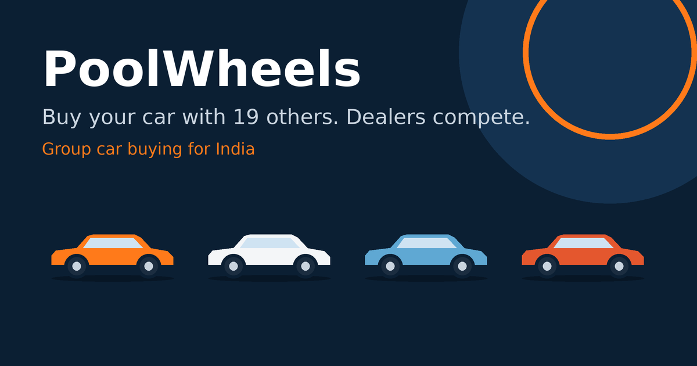

<div align="center">



# 🚗 PoolWheels

**Group car buying for India. Pool buyers, make dealers compete, buy on your terms.**

[](https://github.com/YOUR-USERNAME/poolwheels/actions)
[](LICENSE)
[](https://react.dev)
[](https://vitejs.dev)
[](#-install-as-an-app-pwa)
[](https://capacitorjs.com)
[](#-build-the-android-and-ios-apps)
[](#-build-the-android-and-ios-apps)
[](CONTRIBUTING.md)
[](#-roadmap)

[Live demo](https://YOUR-USERNAME.github.io/poolwheels/) · [Architecture](docs/ARCHITECTURE.md) · [Report a bug](../../issues/new?template=bug_report.md) · [Request a feature](../../issues/new?template=feature_request.md)

</div>

---

## 📑 Table of contents
- [💡 The idea](#-the-idea)
- [✨ Features](#-features)
- [🧭 How it works](#-how-it-works)
- [🧱 Tech stack](#-tech-stack)
- [🗂 Project structure](#-project-structure)
- [🚀 Quick start](#-quick-start)
- [🌐 Deploy the web version](#-deploy-the-web-version)
- [📲 Install as an app (PWA)](#-install-as-an-app-pwa)
- [📱 Build the Android and iOS apps](#-build-the-android-and-ios-apps)
- [🔌 Connect a real backend](#-connect-a-real-backend)
- [🎨 Brand and assets](#-brand-and-assets)
- [🛣 Roadmap](#-roadmap)
- [⚖️ Business and legal notes](#️-business-and-legal-notes)
- [🙋 FAQ](#-faq)
- [🤝 Contributing](#-contributing)
- [🏷 Suggested GitHub topics](#-suggested-github-topics)
- [📄 License](#-license)

## 💡 The idea
In India, buying a car is a one-on-one negotiation where the buyer has the least leverage. A dealer sees one buyer as one sale. The same dealer sees 20 confirmed buyers as a month's target.

PoolWheels pools 15 to 20 buyers who want the same car in the same city, asks several dealerships to bid for the whole group, and shows every bid as an itemised on-road price. Each buyer then decides **individually**. No commitment until you say yes.

**Revenue model:** the platform earns a commission from the dealership, never from the buyer.

## ✨ Features
| | Feature | Status |
|---|---|---|
| 🔎 | Browse open pools, filter by city and car type | ✅ Working (mock data) |
| 🤝 | Join a pool, live buyer count and progress | ✅ Working (mock data) |
| 📊 | Dealer quote comparison with itemised on-road price | ✅ UI done, needs real bids |
| ✅ | Accept or pass on each quote individually | ✅ UI done |
| 📱 | Installable PWA, offline shell | ✅ |
| 🤖 | Android and iOS apps via Capacitor | ⚙️ Config ready, build on your machine |
| 🔐 | Login, saved pools across devices | 🛠 Planned |
| 🏢 | Dealer portal to submit bids | 🛠 Planned |
| 🔔 | Push notifications (pool full, bids in) | 🛠 Planned |

## 🧭 How it works
1. 👥 **Pool.** Pick a city, model, variant and colour. Join the matching pool.
2. 🔨 **Bid.** At 20 buyers, 4 to 5 dealerships are invited to bid for the group.
3. ⚖️ **Compare.** See ex-showroom, insurance, registration and accessories side by side.
4. ✅ **Decide.** Accept or pass. Your loan and paperwork stay between you and the dealer.
5. 🚘 **Drive.** The dealer pays PoolWheels a commission. You pay nothing.

## 🧱 Tech stack
| Layer | Choice |
|---|---|
| UI | React 18, plain CSS, original inline SVG illustrations and icons |
| Build | Vite 5 |
| Web and PWA | Web manifest, service worker |
| Native | Capacitor 6 (Android and iOS) |
| CI and hosting | GitHub Actions, GitHub Pages (or Vercel / Netlify) |
| Backend (planned) | Supabase, Firebase or any REST API behind `src/api.js` |

## 🗂 Project structure
```text
poolwheels/
├── .github/                 # CI, Pages deploy, issue and PR templates
├── assets/                  # Source art: icon, splash, banner (for capacitor-assets)
├── docs/ARCHITECTURE.md     # Diagram and suggested data model
├── public/                  # Manifest, service worker, app icons, social image
├── src/
│   ├── api.js               # Data layer (mock today, swap for real backend)
│   ├── App.jsx              # Screens: pool browser, my pool, quotes
│   ├── CarArt.jsx           # Original car illustration, colour is a prop
│   ├── icons.jsx            # Inline icon set
│   ├── main.jsx             # Entry and service worker registration
│   └── styles.css
├── capacitor.config.json
├── index.html
└── vite.config.js
```

## 🚀 Quick start
Requires Node.js 18 or newer.
```bash
git clone https://github.com/YOUR-USERNAME/poolwheels.git
cd poolwheels
npm install
npm run dev        # http://localhost:5173
npm run build      # production build in dist/
```

## 🌐 Deploy the web version
**GitHub Pages (automatic).** In your repo go to *Settings → Pages → Source: GitHub Actions*. Every push to `main` runs `.github/workflows/deploy-pages.yml` and publishes `dist/`.

**Vercel or Netlify.** Import the repo. Build command `npm run build`, output directory `dist`.

## 📲 Install as an app (PWA)
- **Android (Chrome):** menu → *Install app*.
- **iOS (Safari):** Share → *Add to Home Screen*.

Icons are included: `icon-180.png` (iOS), `icon-192.png`, `icon-512.png`, `icon-maskable-512.png` and `icon.svg`.

## 📱 Build the Android and iOS apps
```bash
npm run cap:add        # once: creates android/ and ios/
npm run cap:assets     # generates native icons and splash from assets/
npm run cap:sync       # build web + copy into native projects
npx cap open android   # needs Android Studio
npx cap open ios       # needs a Mac with Xcode
```
To publish you need a Google Play Console account and an Apple Developer Program membership (paid). Change `appId` in `capacitor.config.json` to a bundle id you own before publishing.

## 🔌 Connect a real backend
Everything the UI needs goes through four functions in `src/api.js`: `listPools`, `joinPool`, `getQuotes` and the pool constants. Replace the in-memory mock with Supabase, Firebase or your own REST API. Copy `.env.example` to `.env` for keys (never commit `.env`). See the suggested data model in [docs/ARCHITECTURE.md](docs/ARCHITECTURE.md).

Quotes stay empty until real dealer bids exist. The UI never shows invented prices.

## 🎨 Brand and assets
| Token | Value |
|---|---|
| Ink | `#0B1F33` |
| Accent | `#FF7A1A` |
| Background | `#F4F6F8` |
| Display font | Bricolage Grotesque |
| Body font | DM Sans |

All illustrations and icons are original vector or generated artwork in this repo. No third-party car photos or logos are included. Car model names appear only as plain text labels.

## 🛣 Roadmap
- [ ] Authentication (phone OTP)
- [ ] Persist pools and members in a database
- [ ] Dealer portal and bid submission
- [ ] Pool matching by variant, colour and delivery window
- [ ] Push notifications
- [ ] Hindi and regional language support
- [ ] End-to-end tests

## ⚖️ Business and legal notes
This is a software prototype, not legal or financial advice. Before launch, get advice on: dealer agreements and published commission terms, consumer protection and data privacy rules (including India's DPDP Act), and how financing and insurance referrals are handled. Keep commission rates identical and public across dealers to protect buyer trust.

## 🙋 FAQ
**Does it work today with real dealers?** No. It is a front-end prototype with mock pools. You need a backend and dealer partnerships.

**Why no car photos?** Manufacturer imagery is copyrighted. Add licensed photos or dealer-supplied images in `public/` when you have rights.

**Is it free for buyers?** That is the model: dealers pay.

## 🤝 Contributing
See [CONTRIBUTING.md](CONTRIBUTING.md). Security issues: [SECURITY.md](SECURITY.md).

## 🏷 Suggested GitHub topics
`car-buying` `group-buying` `india` `automotive` `marketplace` `react` `vite` `pwa` `capacitor` `android` `ios` `mobile-app` `startup` `fintech` `consumer-tech`

## 📄 License
[MIT](LICENSE) © 2026 PoolWheels contributors
