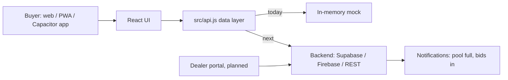

# Architecture

- **One codebase, three targets.** Vite builds static files into `dist/`. The same files are served on the web, installed as a PWA, or bundled by Capacitor into Android and iOS apps.
- **Single seam for data.** The UI only calls `src/api.js`. Replace its functions to go live.
- **No invented prices.** Quotes come only from real dealer bids; with none, the UI shows an empty state.

## Suggested data model
`users`, `pools(model, variant, color, city, window, status)`, `pool_members(pool_id, user_id)`, `dealers`, `bids(pool_id, dealer_id, ex_showroom, insurance, registration, accessories, valid_until)`, `decisions(bid_id, user_id, accepted)`.
